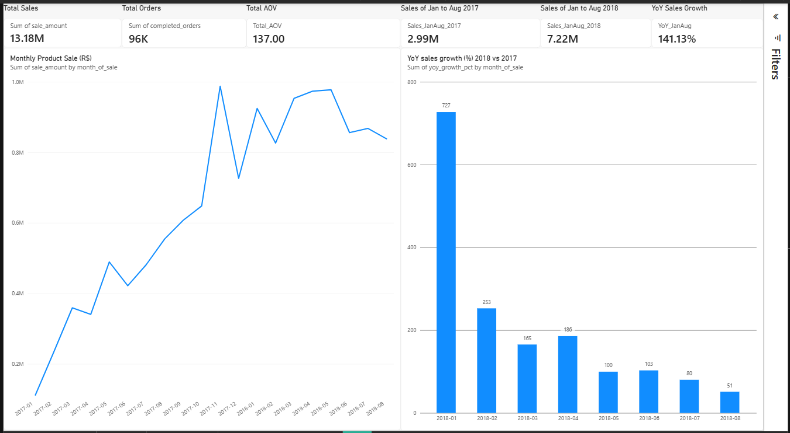
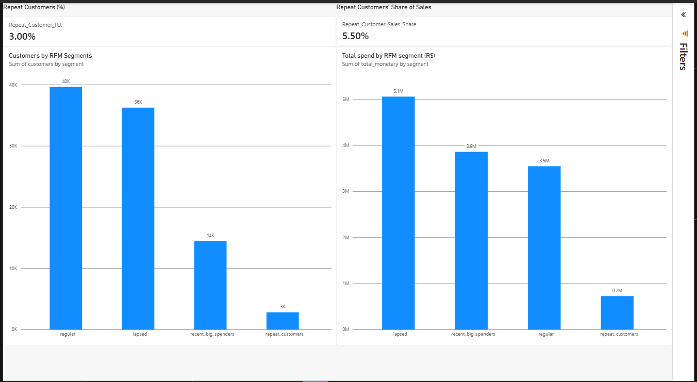

# Olist E-Commerce Analytics

End-to-end analysis of the Brazilian E-Commerce Public Dataset by Olist (Kaggle): PostgreSQL for the analysis, Python for statistical testing, and Power BI for the dashboards.

**Period analysed:** Jan 2017 - Aug 2018, delivered orders. 2016 is excluded because its activity is sparse.

## Business questions
1. How are sales trending, and is growth driven by order volume or order value?
2. How good is delivery, and where and when is it late?
3. Does late delivery hurt customer satisfaction?
4. Do customers come back, and who are the most valuable ones?

## Key findings
- **Sales:** R$13.18M product sales from 96,211 delivered orders (AOV R$137). Jan-Aug 2018 was **+141.13%** vs Jan-Aug 2017 (R$2.99M to R$7.22M), but 2018 monthly sales were flat at R$0.83M-0.98M, so monthly YoY growth fell from 727% to 51% (a base effect). Growth is volume-driven: in Nov 2017 (Black Friday) sales rose 52.37% on +62.77% orders, with AOV down 6.39%.
- **Delivery:** orders arrive in 12.48 days on average against 24.28 days promised, and **6.79% are late**. Lateness is concentrated in Nov 2017 (12.4%), Feb 2018 (14.1%) and Mar 2018 (19.0%), and in MA (17.5%), CE (13.8%), BA (12.2%) and RJ (12.1%). SP is at 4.5%.
- **Reviews:** late orders average **2.27 stars vs 4.29** for on-time orders, and 62.4% of late orders get a 1-2 star review vs 9.3% (about 6.7x). Scores fall with the size of the delay: 4.29, 3.29, 2.10 and 1.70 stars for on-time, 1-3, 4-7 and 8+ days late. Mann-Whitney U, Welch's t-test (gap -2.02 stars, 95% CI -2.06 to -1.98) and chi-square all give p < 0.001. This is an association, not proof of cause.
- **Customers:** only **3.00%** of 93,104 customers ordered more than once, and they bring 5.5% of sales (R$260 per customer vs R$138). In the RFM segmentation, "recent big spenders" are 15.5% of customers but 29% of spend.

## Dashboard

## Tech stack
PostgreSQL, pgAdmin, SQL (CTEs, window functions), Python (pandas, matplotlib, SciPy, SQLAlchemy), Power BI, Git and GitHub.

## Project structure
    data/                   raw CSVs (not committed)
    sql/data_quality/       data quality checks
    sql/business_analysis/  sales, delivery, review and customer queries
    sql/views/              views used by Power BI
    notebook/               EDA and hypothesis tests (late delivery vs reviews)
    reports/                written findings for each module
    dashboards/             Power BI file and screenshots

## Reports
- `reports/data_quality_report.md`
- `reports/business_metrics.md`
- `reports/sales_performance.md`
- `reports/delivery_performance.md`
- `reports/review_analysis.md`
- `reports/customer_analysis.md`

## How to reproduce
1. Download the dataset from Kaggle and import the 9 CSVs into a PostgreSQL database named `olist_ecommerce`.
2. Run the scripts in `sql/business_analysis/` and then `sql/views/powerbi_views.sql`.
3. Run the notebook in `notebook/` (the database password is typed at runtime).
4. Open the `.pbix` file in `dashboards/` and point it at your local PostgreSQL.

## Definitions and limitations
- Sales = product price (excluding freight) of delivered orders, grouped by purchase month.
- A late order is delivered on a later calendar day than the estimated date.
- Repeat customers are counted within the analysis window (by `customer_unique_id`), so someone whose second order falls outside it counts as one-time.
- Delivery by state only includes states with 500+ delivered orders.
- NTILE splits tied values by position, so customers with identical spend can land in different RFM score groups at the boundaries.
